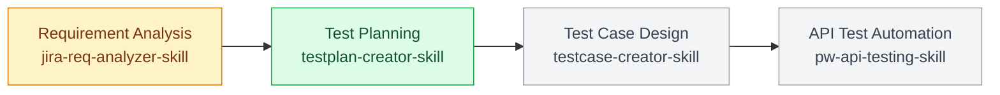
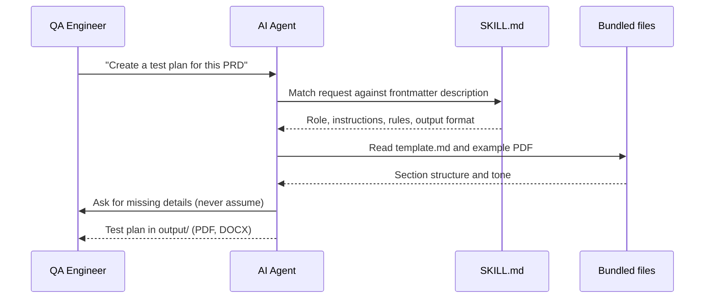
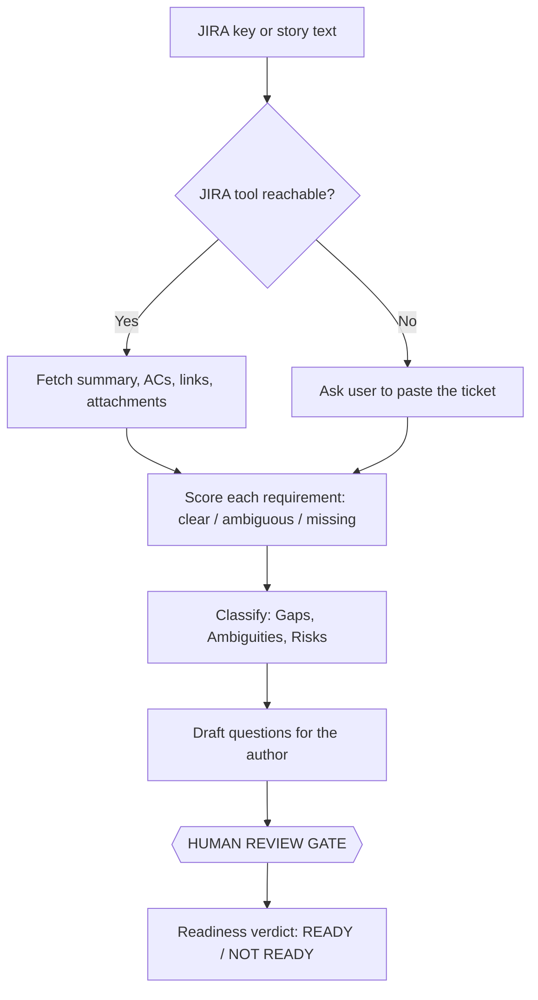
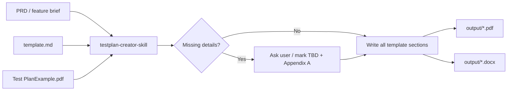
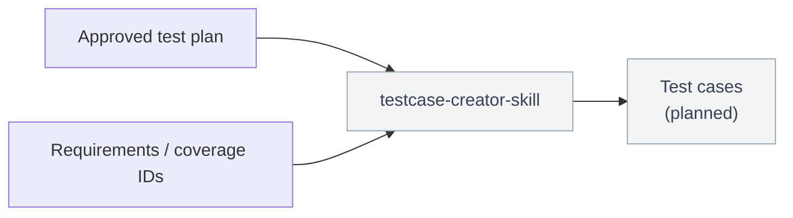
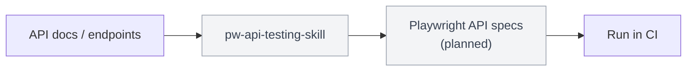
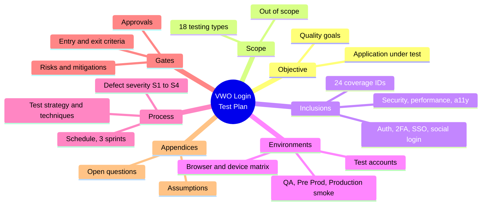
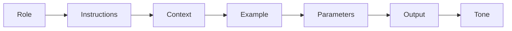

# AgentSkillsQA

Agent Skills for QA engineers. Each folder is a self-contained skill (a `SKILL.md` plus any templates or examples) that teaches an AI coding agent such as Claude Code, Cursor, or GitHub Copilot to do one testing job well, following the Software Testing Life Cycle (STLC).



> Green: ready to use. Amber: written, still marked incomplete. Grey: scaffold copied from the template, instructions not written yet.

## Table of Contents

- [What is an Agent Skill?](#what-is-an-agent-skill)
- [Skills at a glance](#skills-at-a-glance)
- [Project structure](#project-structure)
- [Skills](#skills)
  - [01: JIRA Requirement Analyzer](#01-jira-requirement-analyzer)
  - [02: Test Plan Creator](#02-test-plan-creator)
  - [03: Test Case Creator](#03-test-case-creator)
  - [04: Playwright API Testing](#04-playwright-api-testing)
- [Sample output: VWO Login Dashboard test plan](#sample-output-vwo-login-dashboard-test-plan)
- [Write your own skill (RICE-POT)](#write-your-own-skill-rice-pot)
- [Install and use](#install-and-use)
- [Roadmap](#roadmap)

## What is an Agent Skill?

**Concept:** A skill is a folder with a `SKILL.md` file. Its YAML frontmatter (`name`, `description`) tells the agent *when* to use it, and the Markdown body tells it *how*. Extra files such as templates and example PDFs sit next to it and are read only when needed.

**Why:** Prompts typed into a chat are forgotten. A skill turns your team's best QA process into a reusable, versioned instruction set that any agent can follow the same way every time.

**Q&A: why use this?**
- **Q: When does the agent load a skill?** A: When your request matches the skill's `description` (for example "create a test plan for this PRD"), or when you call it by name.
- **Q: What does it replace?** A: Copy-pasting the same long prompt, template, and examples into every chat.
- **Q: What's the gotcha?** A: The `description` is the trigger. If it is vague, or two skills share the same `name`, the agent picks the wrong one or none at all.



## Skills at a glance

| # | Skill | STLC phase | Status | Input | Output |
|:-:|:------|:-----------|:------:|:------|:-------|
| 01 | [`jira-req-analyzer-skill`](<./(incomplete)jira-req-analyzer-skill/SKILL.md>) | Requirement Analysis | Draft | JIRA key or pasted story | Readiness verdict, gaps, ambiguities, risks, questions |
| 02 | [`testplan-creator-skill`](./testplan-creator-skill/SKILL.md) | Test Planning | Ready | PRD or feature details | Production-ready test plan (PDF, DOCX) |
| 03 | [`testcase-creator-skill`](./testcase-creator-skill/SKILL.md) | Test Case Design | Scaffold | Requirements or test plan | Test cases (planned) |
| 04 | [`pw-api-testing-skill`](./pw-api-testing-skill/SKILL.md) | Test Automation | Scaffold | API docs or endpoints | Playwright API tests (planned) |

## Project structure

```
AgentSkillsQA/
├── README.md
├── skill-template.md                     # starting point for every new skill (RICE-POT)
├── (incomplete)jira-req-analyzer-skill/
│   └── SKILL.md
├── testplan-creator-skill/
│   ├── SKILL.md
│   ├── template.md                       # section-by-section test plan template
│   └── Test PlanExample.pdf              # reference plan (Restful Booker API)
├── testcase-creator-skill/
│   └── SKILL.md
├── pw-api-testing-skill/
│   └── SKILL.md
└── output/
    └── VWO_Login_Dashboard_Test_Plan.pdf # sample run of testplan-creator-skill
```

## Skills

### 01: JIRA Requirement Analyzer

**Concept:** Reads a JIRA ticket (or pasted user story) and decides whether it is actually testable yet. Each requirement is marked clear, ambiguous, or missing.

**Why:** Testing starts badly when acceptance criteria are thin. This skill names the holes before anyone writes a test case.

**Q&A: why use this?**
- **Q: When do I reach for it?** A: In grooming or refinement, or whenever someone asks "is this story ready to test?"
- **Q: What does it replace?** A: A manual read-through of the ticket and a hand-written list of questions for the author.
- **Q: What's the gotcha?** A: It never invents an acceptance criterion. If the JIRA MCP is not reachable it asks you to paste the ticket, and it stops at a human review gate before questions go to the author.



Output shape (from [`SKILL.md`](<./(incomplete)jira-req-analyzer-skill/SKILL.md>)):

```
## Requirement Analysis - <JIRA-KEY>: <title>
Readiness verdict: READY / NOT READY (n blockers)
Gaps            [ ❌ ... ]
Ambiguities     [ ⚠️ ... two readings each ]
Risks           [ impact-rated ]
Questions for the author (numbered, one topic each)
--- HUMAN REVIEW GATE ---
Assumptions / What I could not confirm / "Confirm before I send these to the author"
```

### 02: Test Plan Creator

**Concept:** Turns a Product Requirements Document (PRD) into a complete test plan that follows a fixed company template: objective, scope, inclusions, environments, defect process, strategy, schedule, deliverables, entry and exit criteria, tools, risks, and approvals.

**Why:** Test plans are long, repetitive, and easy to get inconsistent. This skill produces one a QA Lead can review and sign off.

**Q&A: why use this?**
- **Q: When do I reach for it?** A: As soon as a PRD or feature brief lands, with prompts like "create a test plan for this PRD" or "testplan for this feature".
- **Q: What does it replace?** A: Copying last quarter's plan and editing every section by hand.
- **Q: What's the gotcha?** A: It must not assume. Anything the PRD does not say (environment URLs, POCs, dates, thresholds) is marked TBD and turned into an open question, not invented.



Frontmatter and trigger phrases (from [`SKILL.md`](./testplan-creator-skill/SKILL.md)):

```yaml
name: "testplan-creator-skill"
description: "This template will help me to create a test plan in my company, which is Wingify."
version: "1.0.0"
tags:
  - testplan
# When to Use
# - create a test plan for the this PRD
# - testplan for this prd or feature
```

### 03: Test Case Creator

**Concept:** The next STLC step after the plan: generate detailed test cases (steps, data, expected results) from requirements or an approved test plan.

**Why:** Test case design is where coverage gaps hide. A skill keeps the format and the design techniques consistent.

**Q&A: why use this?**
- **Q: When do I reach for it?** A: After the test plan is approved and before execution starts.
- **Q: What does it replace?** A: Writing test cases one by one in a spreadsheet.
- **Q: What's the gotcha?** A: It is a **scaffold** today. `SKILL.md` is still the generic template, and its `description` must be rewritten before the agent can trigger it reliably.



Current frontmatter (from [`SKILL.md`](./testcase-creator-skill/SKILL.md)):

```yaml
name: "testcase-creator-skill"
description: "A concise description of what this skill does (10-500 chars)."
testingTypes:
  - e2e
frameworks:
  - playwright
```

### 04: Playwright API Testing

**Concept:** A skill for writing API tests with Playwright's request fixture: create, read, update, and delete calls with status and schema assertions.

**Why:** API tests are fast and stable, and an agent following one pattern produces suites that are easy to review.

**Q&A: why use this?**
- **Q: When do I reach for it?** A: When automating REST endpoints, for example a booking API with auth tokens.
- **Q: What does it replace?** A: Ad hoc Postman collections that never make it into CI.
- **Q: What's the gotcha?** A: It is a **scaffold** today, and its frontmatter still says `name: "testcase-creator-skill"`. Two skills with the same name collide, so rename it before installing both.



Current example in the skill (from [`SKILL.md`](./pw-api-testing-skill/SKILL.md)):

```typescript
test('user can log in', async ({ page }) => {
  await page.goto('/login');
  await page.fill('[name="email"]', 'user@example.com');
  await page.fill('[name="password"]', 'password');
  await page.click('button[type="submit"]');
  await expect(page).toHaveURL('/dashboard');
});
```

## Sample output: VWO Login Dashboard test plan

[`output/VWO_Login_Dashboard_Test_Plan.pdf`](./output/VWO_Login_Dashboard_Test_Plan.pdf) is a real run of **testplan-creator-skill** on the PRD for the VWO login page (`app.vwo.com`). It is 20 A4 pages and maps the PRD to 24 coverage IDs (LGN-01 to LGN-24) with P0 to P3 priorities. It also includes 18 open questions for the PRD owners instead of guessed values.



## Write your own skill (RICE-POT)

Start from [`skill-template.md`](./skill-template.md). Its body follows the [RICE-POT prompt framework](https://github.com/PramodDutta/AITesterBlueprint3x/blob/main/chapter_02_Prompt_Eng/Project1_TC_Gen/RICE_POT_FRAMEWORK/RICE_POT.md), the same structure `testplan-creator-skill` uses.



| Block | What to write | Example from testplan-creator-skill |
|:------|:--------------|:-------------------------------------|
| Role | Who the agent is | QA engineer with 15 years of functional and non-functional testing |
| Instructions | The one job to do | Turn a PRD into a test plan using the template |
| Context | What it already has | PRD from the user, `template.md` in the same folder |
| Example | A reference output | `Test PlanExample.pdf` |
| Parameters | Rules and limits | Never assume; ask for missing details; safety rules |
| Output | Format and location | PDF and DOCX in `output/` |
| Tone | Voice | Professional, production-ready |

## Install and use

Copy a skill into your personal or project skills folder, then ask for the task in plain English.

```bash
git clone https://github.com/PramodDutta/agentskillsqa.git
cd agentskillsqa

# personal (all projects)
mkdir -p ~/.claude/skills
cp -r testplan-creator-skill ~/.claude/skills/

# or project only
mkdir -p .claude/skills
cp -r testplan-creator-skill .claude/skills/
```

Then in Claude Code:

```
create a test plan for this PRD: <paste PRD>
```

## Roadmap

- [x] `testplan-creator-skill`: PRD to test plan, with a sample output
- [ ] `testplan-creator-skill`: add the closing `---` to the frontmatter so it parses as YAML
- [ ] `jira-req-analyzer-skill`: finish, test against real tickets, drop the `(incomplete)` prefix
- [ ] `testcase-creator-skill`: write RICE-POT instructions and a real `description`
- [ ] `pw-api-testing-skill`: rename frontmatter `name`, write instructions and API examples

---

Author: Pramod Dutta. Skills are MIT licensed, as declared in each `SKILL.md`.
